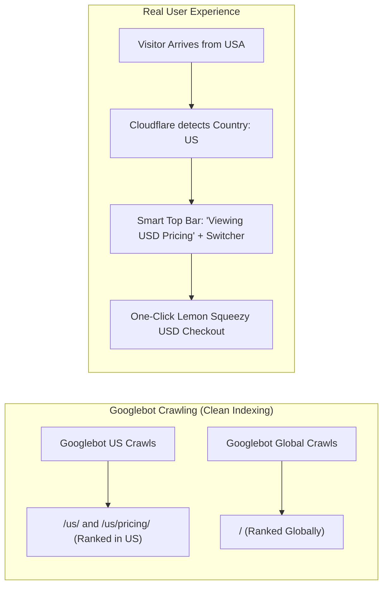
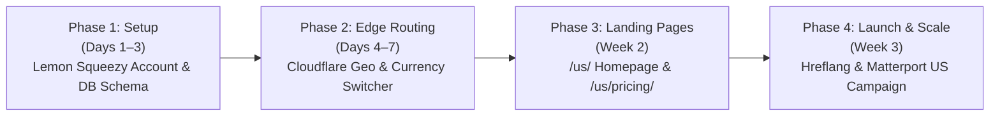

# PanoPublish — Global Expansion Architecture & USD Monetization Masterplan

> **Status:** Backlogged for Future Implementation  
> **Target Timeline:** Post-India SEO Stabilization  
> **Objective:** Transition PanoPublish from an India-centric platform into a dual-market global SaaS: preserving the domestic Indian engine (INR, UPI, Razorpay, GST) while deploying dedicated global landing pages, international SEO, and automated US Dollar (USD) subscription processing.  
> **Target Markets:** United States, United Kingdom, Canada, Australia, European Union, and International Creators  

---

## Executive Overview: The Dual-Market SaaS Blueprint

PanoPublish currently has an optimized domestic funnel in India. However, the Google Search Console audit revealed that **the United States already accounts for 3,271 impressions (over 20% of all search visibility)** despite zero US-targeted marketing. 

Converting international demand requires addressing three fundamental barriers:
1. **The Payment Barrier:** International users cannot pay via UPI or RuPay, and foreign credit cards face high decline rates on Indian Razorpay checkouts due to 3D-Secure and RBI compliance rules.
2. **The SEO Geo-Lock:** The website currently hardcodes `<meta name="geo.region" content="IN-GJ" />` and `<link rel="alternate" hrefLang="en-in" />` across all pages, signaling to Google US that the site is exclusively for Indian audiences.
3. **The Value Proposition Mismatch:** Indian photographers care about flat INR pricing, UPI AutoPay, and GST tax credit; US/global photographers care about **Matterport/CloudPano cost elimination ($15/tour savings), MLS compliance, Stripe/PayPal checkout, and Zapier integrations.**

```mermaid
flowchart TD
    Visitor["Incoming Web Visitor<br/>(Cloudflare Edge)"] --> Geo{"Cloudflare Edge Detection<br/>(request.cf.country)"}
    
    Geo -->|Country == 'IN'| IN_Flow["Domestic India Funnel<br/>(panopublish.com)"]
    IN_Flow --> IN_Pricing["INR Pricing (₹499 - ₹2,999)<br/>UPI / RuPay / NetBanking"]
    IN_Pricing --> Razorpay["Razorpay Gateway<br/>+ Automated GST Invoices"]
    
    Geo -->|Country != 'IN' (US, UK, EU, CA)| Global_Flow["Global / US Funnel<br/>(panopublish.com/us/ or Currency Switch)"]
    Global_Flow --> USD_Pricing["USD Pricing ($9 - $59)<br/>Credit Cards / Apple Pay / Google Pay"]
    USD_Pricing --> MoR["Lemon Squeezy / Paddle<br/>(Merchant of Record - Zero US Tax Hassle)"]
    
    Razorpay --> SubDB["Unified Supabase Subscriptions DB<br/>(gateway: 'razorpay' | 'lemonsqueezy')"]
    MoR --> SubDB
```

---

## 1. Global Payment Gateway Strategy: How to Charge in USD from India

As an Indian company/founder, accepting recurring USD subscriptions from the US and Europe involves specific regulatory and tax requirements.

### Option Comparison for Global Billing

| Provider | Merchant of Record (MoR)? | Handles US Sales Tax & EU VAT? | Indian Bank Payouts? | Recurring Subscriptions? | Recommendation |
| :--- | :---: | :---: | :---: | :---: | :--- |
| **Lemon Squeezy** *(by Stripe)* | **Yes** | **Yes (100% automated)** | **Yes (USD via Wise or Direct Wire)** | **Excellent (Native SaaS portal)** | **⭐️ Top Choice (Fastest & Safest)** |
| **Paddle** | **Yes** | **Yes (100% automated)** | **Yes (Direct Wire / Payoneer)** | **Excellent** | **Alternative MoR** |
| **Dodo Payments** | **Yes** | **Yes** | **Yes (Built for Indian SaaS)** | **Good** | Emerging Indian Founder MoR |
| **Stripe (Direct / India)** | No | No (You must file sales tax in 50 US states) | Yes (INR conversion mandatory) | Good | High accounting overhead |
| **Razorpay International** | No | No | Yes | Poor (High foreign card failure rate) | ❌ Not recommended for USD |

### Why a Merchant of Record (MoR) like Lemon Squeezy is Essential

> [!IMPORTANT]
> When you sell software directly to customers in the US and Europe via direct Stripe, **you are legally obligated to register and remit sales tax across US states** (economic nexus laws) and VAT MOSS in the European Union.
> 
> A **Merchant of Record (Lemon Squeezy or Paddle)** solves this completely:
> 1. Lemon Squeezy is the legal seller of the software.
> 2. They calculate, collect, and pay all US state sales tax and EU VAT on your behalf.
> 3. They provide customers with Apple Pay, Google Pay, and international credit cards without 3DS friction.
> 4. They deposit your net software revenue directly into your Indian bank account or Wise account twice a month.

---

## 2. Global USD Pricing Architecture

International creators compare PanoPublish against **CloudPano ($33–$49/mo)**, **Matterport ($79–$300/mo + $14.99/upload)**, and **GoThru ($10–$25/mo)**. 

Pricing at $9, $29, and $59 positions PanoPublish as an irresistible, modern disruption while yielding **~3.5x higher revenue per customer** than Indian plans:

| Tier | India Plan (Razorpay) | Global / US Plan (Lemon Squeezy) | Annual Discount (USD) | Key Features Highlighted for US/Global |
| :--- | :---: | :---: | :---: | :--- |
| **Starter / Basic** | ₹499 / mo (~$6) | **\$9 / month** | \$79 / year *(Save 27%)* | 5 Google Maps Tours, EXIF GPS auto-pathing, standard nadir blur, email support. |
| **Professional** | ₹1,499 / mo (~$18) | **\$29 / month** | \$249 / year *(Save 28%)* | 20 Active Tours, 3 Team seats, Custom PNG Nadir Branding, Custom Walkthrough Player, Priority Support. |
| **Agency / Business**| ₹2,999 / mo (~$36) | **\$59 / month** | \$499 / year *(Save 30%)* | 50 Active Tours, 10 Team seats, White-Label Client Links, MLS Compliant Links, API access. |

---

## 3. URL & Routing Architecture: Separate Pages vs Dynamic Routing

Google Webmaster Guidelines strictly dictate how international websites should be structured.

### The Winning Structure: Subfolder Architecture (`/us/` + Currency Toggle)

```
panopublish.com/               --> Primary Global / India (Auto-adaptive)
panopublish.com/pricing/       --> Default Pricing (with persistent USD/INR toggle)
panopublish.com/us/            --> Dedicated US/Global Landing Page
panopublish.com/us/pricing/    --> Dedicated USD Pricing Page ($9, $29, $59)
panopublish.com/us/matterport-alternative/ --> High-ticket US competitor page
```



> [!CAUTION]
> **Never force a hard 301/302 IP redirect for all US traffic!**  
> Googlebot crawls the web almost entirely from US-based IP addresses. If you force-redirect all US visitors from `/` to `/us/`, Googlebot will be permanently blocked from ever seeing or indexing your original pages.  
> **Best Practice:** Use a sleek geo-notification banner: *"Visiting from outside India? [Switch to USD Plans ($9/mo) →]"* while allowing direct indexing of both routes.

---

## 4. International SEO Overhaul: Unlocking US & European SERPs

### A. Removing the India Geo-Lock in `SEO.tsx`
Currently, `src/components/SEO.tsx` has hardcoded tags:
```tsx
// CURRENT (Harmful to US Rankings):
<meta name="geo.region" content="IN-GJ" />
<meta name="geo.placename" content="Ahmedabad" />
<link rel="alternate" hrefLang="en-in" href={canonicalUrl} />
<link rel="alternate" hrefLang="x-default" href={canonicalUrl} />
```

### B. The Upgraded International `hreflang` Pattern:
```tsx
// PROPOSED DUAL-LOCALE CONFIGURATION:
interface SEOProps {
  // ...
  locale?: "in" | "us" | "global";
}

// In Head:
{locale === "in" ? (
  <>
    <meta name="geo.region" content="IN-GJ" />
    <meta name="geo.placename" content="Ahmedabad" />
    <link rel="alternate" hrefLang="en-in" href="https://panopublish.com/" />
    <link rel="alternate" hrefLang="x-default" href="https://panopublish.com/" />
  </>
) : (
  <>
    <link rel="alternate" hrefLang="en-us" href="https://panopublish.com/us/" />
    <link rel="alternate" hrefLang="en-gb" href="https://panopublish.com/us/" />
    <link rel="alternate" hrefLang="en-ca" href="https://panopublish.com/us/" />
    <link rel="alternate" hrefLang="x-default" href="https://panopublish.com/us/" />
  </>
)}
```

---

## 5. Technical Implementation: Code & Database Blueprint

### Step 1: Database Migration (`subscriptions` Table in Supabase)
To support both Razorpay and Lemon Squeezy simultaneously without breaking existing users:

```sql
-- Add multi-gateway support to the existing subscriptions table
ALTER TABLE public.subscriptions 
ADD COLUMN IF NOT EXISTS payment_gateway VARCHAR(30) DEFAULT 'razorpay',
ADD COLUMN IF NOT EXISTS external_subscription_id VARCHAR(255),
ADD COLUMN IF NOT EXISTS currency VARCHAR(10) DEFAULT 'INR',
ADD COLUMN IF NOT EXISTS customer_id VARCHAR(255);

-- Create index for webhook lookup speed
CREATE INDEX IF NOT EXISTS idx_subs_external_id ON public.subscriptions(external_subscription_id);
```

### Step 2: Supabase Webhook Handler (`lemon-squeezy-webhook`)
Create an Edge Function `supabase/functions/lemonsqueezy/index.ts` to handle:
* `subscription_created`
* `subscription_updated`
* `subscription_cancelled`
* `subscription_payment_success`

### Step 3: Frontend Checkout Selector (`PricingPage` & `Settings`)
1. Detect country from Cloudflare headers (`cf-ipcountry` passed in loader or context) or user preference in `localStorage`.
2. Render:
   * If currency is **INR**: Launch Razorpay Checkout Modal (UPI, NetBanking, Cards).
   * If currency is **USD**: Open Lemon Squeezy Hosted Checkout URL (Credit Cards, Apple Pay, Google Pay).

---

## 6. Execution Roadmap (4-Phase Rollout)



### Phase 1: Setup & Gateway Registration (Days 1–3)
- Register an account on **Lemon Squeezy** (or Paddle) under your company/personal details.
- Create 3 subscription products in Lemon Squeezy:
  - *Starter Plan:* \$9/mo or \$79/yr
  - *Pro Plan:* \$29/mo or \$249/yr
  - *Agency Plan:* \$59/mo or \$499/yr
- Run the SQL migration to add `payment_gateway` and `currency` to Supabase `subscriptions`.

### Phase 2: Webhook & Billing Engine (Days 4–7)
- Deploy `supabase/functions/lemonsqueezy/index.ts` to handle Lemon Squeezy webhook events.
- Test subscription lifecycle: checkout → activate Pro → renewal credit refresh → cancellation.

### Phase 3: Global Landing Pages & Currency Switcher (Week 2)
- Add a currency toggle in the navbar (`🇮🇳 ₹ INR` / `🇺🇸 $ USD`).
- Create `src/routes/us.index.tsx` (Global Home) and `src/routes/us.pricing.tsx` (USD Pricing).
- Create US-specific value props: *"Stop Paying Matterport $14.99 Per Street View Upload"*.

### Phase 4: International SEO & hreflang Fixes (Week 3)
- Update `SEO.tsx` to conditionally serve `en-in` and `en-us` tags.
- Submit updated sitemap containing `/us/` routes to Google Search Console.
- Monitor US impressions and CTR growth over the following 30 days.

---

## Summary Recommendation

You **do not need to rebuild PanoPublish** or disturb your successful Indian user base to go global. 

By adding **Lemon Squeezy as a Merchant of Record alongside Razorpay**, introducing a **currency toggle**, and deploying **`/us/` landing pages with corrected `hreflang` tags**, you will safely unlock 3x higher revenue per customer in US Dollars while keeping domestic UPI and GST operations 100% intact.
