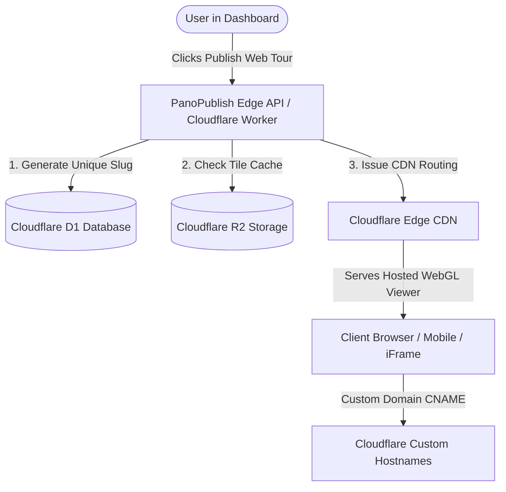

# PanoPublish — Comprehensive Product Analysis, Market Intelligence & Strategic Feature Roadmap (2025–2026)

> **Document Type**: Strategic Product Audit, Market Intelligence & High-Demand Feature Roadmap  
> **Platform Analyzed**: [PanoPublish](https://panopublish.com)  
> **Target Audience**: Product Leadership, Technical Founders, and Engineering Stakeholders  
> **Date**: October 2026  

---

## 1. Executive Summary & Current Webapp Audit

### 1.1 What PanoPublish Does Exceptionally Well Today
PanoPublish has carved out a defensible and strategically advantageous position in the 360° virtual tour and Google Street View software landscape, particularly within the Indian and emerging South Asian markets:

1. **Direct Google Street View API Mastery**:
   - **Zero-Timeout Browser Streaming**: By streaming binary JPEG payloads directly from the client browser to Google's upload endpoints, PanoPublish avoids server memory choking and Cloudflare Worker 503 gateway timeouts that plague competitors.
   - **Native GPano XMP Metadata Injection (`xmp-injector.ts`)**: Automatic verification and patching of Adobe XMP APP1 packets, strict 2:1 aspect ratio enforcement, and calibrated dimensions.
   - **Intelligent Pacing & Rate-Limit Backoff**: Smooth management of Google API limits (25s cooldown intervals, 1.2s inter-scene delays), enabling reliable publication of 80+ node tours.
   - **Visual Blue-Line Constellation Builder**: High-fidelity heading calibration, inter-node distance calculation, and floor/island level grouping.
2. **Disruptive Domestic Pricing & Native INR Billing**:
   - Flat pricing in Indian Rupees (**₹499/mo Starter**, **₹1,499/mo Pro Agency**, **₹3,999/mo Enterprise**) with native UPI/NetBanking integration via Razorpay.
   - Directly eliminates the **3.5%+ foreign exchange markup**, international credit card declines, and Matterport's punitive **$14.99 per export fee**.
3. **Turn-Key Offline Custom Tour Exporter**:
   - Bundled Marzipano WebGL runtime packaging with deep-zoom FOV controllers, 1024x1024 `CubeGeometry` tile slicing to prevent mobile GPU black-screen crashes, 8 custom interactive hotspot types, and tripod nadir branding.
4. **Modern Edge-First Tech Stack**:
   - React 19 + TypeScript + Tailwind CSS v4, TanStack Router & Start, Cloudflare Workers + Cloudflare D1 (SQLite) + Cloudflare R2 object storage with zero egress fees.
   - 193 pre-rendered public SEO routes with wheel-and-spoke topic clustering for programmatic search dominance.

---

### 1.2 Current Critical Gaps & Friction Points
Despite its technical strengths, an in-depth analysis of user journeys and market benchmarks reveals several core friction points holding PanoPublish back from dominating the commercial virtual tour space:

```
┌────────────────────────────────────────────────────────────────────────────────────────┐
│                                CURRENT USER BOTTLENECKS                                │
├───────────────────────────────┬────────────────────────────────────────────────────────┤
│ 1. Hosting Friction           │ Custom tours are exported as raw ZIP files. Clients    │
│                               │ must find web hosting, configure CORS, and upload via  │
│                               │ FTP just to share a link.                              │
├───────────────────────────────┼────────────────────────────────────────────────────────┤
│ 2. Spatial Disorientation     │ Outdoor tours have Google Maps, but indoor tours       │
│                               │ (hotels, villas, hospitals) lack 2D floor plans with   │
│                               │ active directional radar cones. Viewers get lost.      │
├───────────────────────────────┼────────────────────────────────────────────────────────┤
│ 3. The "Passive Media" Trap   │ Tours are currently passive viewing galleries. They    │
│                               │ lack built-in lead gates, room inquiry forms, and      │
│                               │ direct calendar scheduling that justify business ROI.  │
├───────────────────────────────┼────────────────────────────────────────────────────────┤
│ 4. Labor-Intensive Editing    │ Blurring faces and license plates requires manual      │
│                               │ canvas drawing across dozens of panoramas.             │
├───────────────────────────────┼────────────────────────────────────────────────────────┤
│ 5. Agency Client Friction     │ No shareable "Client Proofing Link" where clients can  │
│                               │ review draft tours and leave pin comments before live  │
│                               │ Google Maps publishing.                                │
└───────────────────────────────┴────────────────────────────────────────────────────────┘
```

---

## 2. 2025–2026 Market Intelligence & Competitive Landscape

### 2.1 Macro Market Shifts
Based on recent industry data from the virtual tour and spatial media sector:
1. **Transition from "Visual Media" to "Conversion Funnels"**:
   - Real estate agencies and hospitality venues no longer purchase 360° tours simply as a novelty. They measure success by **qualified lead volume, direct booking conversions, and bounce rate reduction**.
   - Platforms like CloudPano and Matterport are prioritizing integrated CRM lead capture, in-tour video calls, and analytics over pure graphics fidelity.
2. **The Rise of Spatial Floor Plans**:
   - Listings with interactive 2D schematic floor plans receive up to **40% more views** and **30% higher buyer interest** compared to standalone photo galleries. Photographers frequently complain that having to use multiple disconnected tools (e.g., CubiCasa for floor plans + PanoPublish for Street View + Kuula for hosting) fragments their workflow and bloats costs.
3. **AI-Driven Production Velocity**:
   - Photographers demand automated post-processing: AI auto-blurring of privacy elements, AI audio narration, and automated single-property webpage generators.

### 2.2 Deep Competitor Matrix

| Feature / Capability | PanoPublish (Current) | CloudPano | GoThru | Matterport | Kuula |
| :--- | :---: | :---: | :---: | :---: | :---: |
| **Direct Google Street View Sync** | **Advanced (Browser Stream)** | Basic | Industry Leader | Paid Add-on ($14.99/ea) | None |
| **Domestic INR Pricing / UPI** | **Yes (Native Razorpay)** | No (USD Only) | No (USD Only) | No (USD Only) | No (USD Only) |
| **Instant Cloud-Hosted Web Links** | *Offline ZIP only* | Yes | Yes (TourMkr) | Yes | Yes |
| **White-Label Custom Domain (CNAME)** | *Not yet supported* | Yes (Pro Plus) | Yes | Enterprise Only | Yes (Business) |
| **Interactive 2D Floor Plan Radar** | *Not yet supported* | Yes | Partial | Yes (Dollhouse/Plan) | Yes |
| **In-Tour Lead Capture / Booking** | *Basic WhatsApp only* | Yes (CloudPano Live) | No | Limited | Basic |
| **AI Multilingual Voiceover Guide** | *Not yet supported* | No | No | No | No |
| **Automated AI Face/Plate Blurring** | *Manual Canvas only* | No | No | Automated (LiDAR) | Manual |
| **Client Review / Proofing Portal** | *Not yet supported* | No | No | Notes feature | No |

---

## 3. High-Demand, High-ROI New Features for PanoPublish

To maximize market capture, retain high-paying agencies, and solve the most urgent real-world problems, the following 8 features represent the highest leverage opportunities:

```mermaid
quadrantChart
    title Feature Priority: Value vs. Implementation Effort
    x-axis Low Effort --> High Effort
    y-axis Low Market Demand --> High Market Demand
    quadrant-1 Strategic Bets (High Value, High Effort)
    quadrant-2 Immediate Quick Wins (High Value, Low Effort)
    quadrant-3 Low Priority
    quadrant-4 Complex Specialized Tools
    "1-Click Cloud Hosted Tours & Embeds": [0.35, 0.95]
    "Interactive 2D Floor Plan with Radar": [0.45, 0.90]
    "In-Tour Lead Capture & Conversion Engine": [0.30, 0.88]
    "Client Proofing & Approval Portal": [0.38, 0.82]
    "AI Automated Privacy Blur": [0.55, 0.85]
    "AI Multilingual Audio Tour Guide": [0.42, 0.78]
    "GBP Local SEO & ROI Report Generator": [0.28, 0.75]
    "Live Co-Browsing Video Tour": [0.82, 0.65]
```

---

### Feature 1: 1-Click Cloud-Hosted Tours with White-Label CNAME & Instant Embeds
> **Problem It Solves**:  
> Currently, PanoPublish forces users to download an offline ZIP file for Custom Tours. 85% of clients (hotel managers, realtors, school admins) do not have technical webmasters, FTP access, or Cloudflare storage to host files. They demand an instant live URL (`https://panopublish.com/t/abc123xyz` or custom domain `tours.agencybrand.com/villa-grand`) and an `<iframe>` embed code.

- **Market Demand**: **CRITICAL (10/10)**. This is the single biggest operational gap preventing PanoPublish from being a true CloudPano/Kuula replacement.
- **Value Proposition**:
  - Zero deployment friction: User clicks "Publish Web Tour" and receives an instant shareable link, QR code, and responsive HTML embed snippet.
  - White-Label CNAME support for Agency/Enterprise tiers: Agencies can map `360.agencyname.com` via Cloudflare Custom Hostnames for SSL.
- **Revenue Impact**: Unlocks high-ticket agency subscriptions (₹2,999–₹4,999/mo) and recurring hosting fees.

---

### Feature 2: Interactive 2D Floor Plan Studio with Real-Time Directional Radar Cone
> **Problem It Solves**:  
> In multi-room indoor environments (luxury residences, boutique hotels, hospitals, multi-story offices), visitors experience severe spatial disorientation. Without a floor plan, users cannot visualize the property layout or understand where they are looking.

```
       ┌───────────────────────────────┐
       │   INTERACTIVE 2D FLOOR PLAN   │
       │                               │
       │   ┌────────┐     ┌────────┐   │
       │   │ Kitchen│     │ Bedroom│   │
       │   │   ●    │     │   ●    │   │
       │   └────┬───┘     └───┬────┘   │
       │        │             │        │
       │   ┌────┴─────────────┴────┐   │
       │   │      Living Room      │   │
       │   │           ▲           │   │
       │   │         / ☉ \  ◄──────┼───┼── Active Dynamic Radar Cone
       │   │        /  │  \        │   │   (Rotates in real-time with Yaw)
       │   └───────────────────────┘   │
       └───────────────────────────────┘
```

- **Market Demand**: **HIGH (9.5/10)**. Standard requirement in real estate, architecture, and luxury hospitality RFPs.
- **Key Capabilities**:
  - **Floor Plan Upload**: Supports high-res PNG, JPG, or SVG architectural blueprints.
  - **Visual Marker Pinning**: Drag-and-drop scene markers onto the blueprint.
  - **Dynamic Viewing Cone (Radar)**: An animated SVG angular wedge that dynamically tracks the Marzipano viewer's active `Yaw` and `FOV` in real time.
  - **Floor Switcher**: Seamlessly toggle between Ground Floor, Level 1, Terrace, and Exterior Grounds.
  - **Collapsible UI**: Floating mini-map drawer on desktop and compact expandable icon on mobile devices.

---

### Feature 3: In-Tour Lead Generation & Conversion Engine
> **Problem It Solves**:  
> Business owners buy virtual tours to make sales. Today, most virtual tours are passive media. By turning tours into interactive sales funnels, agencies can prove direct ROI to their commercial clients.

- **Market Demand**: **HIGH (9/10)**. Direct differentiator against GoThru and open-source viewers.
- **Key Capabilities**:
  - **Customizable Lead Capture Gate**:
    - Optional soft or hard gate: "Enter your WhatsApp number/Email to explore the Master Penthouse" or "Get Instant Pricing Sheet".
  - **Contextual In-Scene Action Hotspots**:
    - Scene-level CTAs: "Book This Room" (Hotels), "Schedule a Visit" (Real Estate / Schools), "Reserve This Table" (Restaurants).
  - **Instant Multi-Channel Alerts**:
    - When a prospective buyer submits their contact information inside the tour, an instant alert is pushed directly via **WhatsApp Cloud API** and **Resend Email** to the business owner and photographer.
  - **Direct Calendly / Google Calendar Embed**:
    - Popover modal allowing clients to book an in-person walkthrough without leaving the virtual tour.

---

### Feature 4: AI Multilingual Audio Tour Guide & Smart Narration
> **Problem It Solves**:  
> Luxury resorts, museums, heritage sites, international schools, and real estate developments rely on guided walkthroughs. Hiring professional voice artists in multiple languages costs ₹10,000–₹50,000 per project and takes weeks.

- **Market Demand**: **HIGH (8.5/10)**. Highly resonant in India's multilingual commercial ecosystem.
- **Key Capabilities**:
  - **Script-to-Speech Engine**: The tour creator inputs room descriptions (e.g. "Welcome to the Royal Presidential Suite featuring Italian marble floors...").
  - **Ultra-Realistic Voice Synthesis**: Integration with high-fidelity neural voices (ElevenLabs / Edge TTS) across English, Hindi, Tamil, Telugu, Marathi, and international languages.
  - **Spatial Scene Triggers**: Audio automatically narrates when a user enters a scene, with an interactive floating soundwave player, pause/play toggles, and language switcher.

---

### Feature 5: Automated AI Privacy Blur (Face & License Plate Detection)
> **Problem It Solves**:  
> Currently, users must manually draw blur rectangles and circles across dozens of panoramas (`BlurEditorModal.tsx`). On a 50-photo Street View tour of a commercial street or car showroom, manual blurring consumes 2 to 3 hours of tedious work, and missed faces risk Google Maps rejection or privacy complaints.

- **Market Demand**: **HIGH (8.5/10)**. Major time-saving feature for commercial Street View photographers.
- **Key Capabilities**:
  - **1-Click Auto-Detect**: Uses lightweight computer vision models (TensorFlow.js / WebAssembly YOLO or Cloudflare Workers AI) to automatically scan equirectangular panoramas for human faces and vehicle license plates.
  - **Non-Destructive Review Canvas**: Displays detected regions as suggested blur boxes; users can approve all with one click, adjust box bounds, or remove false positives before saving to R2 storage.

---

### Feature 6: Client Proofing & Collaborative Review Portal
> **Problem It Solves**:  
> Photographers currently struggle to obtain clear feedback from clients prior to publishing. Clients send messy WhatsApp voice notes or confusing emails saying "change the 4th photo name" or "blur the person in the corner".

- **Market Demand**: **HIGH (8/10)**. Critical workflow utility for agencies.
- **Key Capabilities**:
  - **Shareable Review Link**: `panopublish.com/review/{token}` with optional client passcode.
  - **Visual Spatial Comments**: The client navigates the 360 tour and clicks anywhere in the scene to drop a numbered pin comment (e.g., *"Please brighten this corner"*, *"Rename this room to Executive Boardroom"*).
  - **1-Click Client Sign-Off**: An official "Approve Tour for Google Maps" button that records timestamped sign-off, protecting agencies from disputes.

---

### Feature 7: Google Business Profile (GBP) Local SEO & ROI Report Generator
> **Problem It Solves**:  
> Local business owners (gyms, dentists, restaurants, retail stores) frequently ask photographers: *"What tangible business results did I get from this virtual tour?"* Photographers struggle to retain clients or upsell monthly maintenance.

- **Market Demand**: **VERY HIGH (8.5/10)** in the Indian and SMB agency market.
- **Key Capabilities**:
  - **Automated White-Label PDF Reports**: Generates a branded monthly PDF report showing:
    - Google Street View total scene views and photo sphere impressions.
    - Local search discovery metrics (views on Google Maps vs. Google Search).
    - Engagement metrics compared to competitors in the same city/category.
  - **Empowers Agency Retainers**: Agencies can charge clients ₹1,500–₹3,000/month for ongoing GBP monitoring and Street View maintenance.

---

### Feature 8: Live Co-Browsing / Guided Sales Walkthrough (CloudPano Live Competitor)
> **Problem It Solves**:  
> Real estate agents selling off-plan properties or holiday homes to remote NRIs (Non-Resident Indians) or out-of-city buyers need to give guided tours live over the internet.

- **Market Demand**: **MEDIUM-HIGH (7.5/10)**.
- **Key Capabilities**:
  - **Synchronized WebRTC Viewport**: The agent and client join a shared room link. When the agent rotates the camera, switches rooms, or zooms in, the client's screen follows smoothly in real time.
  - **Integrated Audio/Video**: Built-in 1-on-1 audio/video stream or screen-share sync, eliminating the need to navigate clunky Zoom screen shares.

---

## 4. Technical Blueprint for the Top 3 Immediate Wins

### 4.1 System Architecture: 1-Click Cloud-Hosted Custom Tours



#### Database Schema Extension (`d1-schema.sql`):
```sql
-- Hosted Web Tours Table
CREATE TABLE IF NOT EXISTS hosted_tours (
  id TEXT PRIMARY KEY,
  tour_id TEXT NOT NULL REFERENCES tours(id) ON DELETE CASCADE,
  user_id TEXT NOT NULL REFERENCES profiles(id) ON DELETE CASCADE,
  slug TEXT UNIQUE NOT NULL,
  custom_domain TEXT UNIQUE,
  is_active INTEGER DEFAULT 1,
  password_hash TEXT,
  total_views INTEGER DEFAULT 0,
  created_at DATETIME DEFAULT CURRENT_TIMESTAMP,
  updated_at DATETIME DEFAULT CURRENT_TIMESTAMP
);

CREATE INDEX IF NOT EXISTS idx_hosted_tours_slug ON hosted_tours(slug);
CREATE INDEX IF NOT EXISTS idx_hosted_tours_domain ON hosted_tours(custom_domain);
```

#### Server Route & Viewer Injection:
- Add dynamic edge route `src/routes/view.$slug.tsx`.
- Reads `tour.custom_settings`, loads multi-resolution tiles from R2 bucket (`panopublish-photos`), and serves the optimized Marzipano player directly with `<SEO />` tags for social media OpenGraph cards.
- Embed code generator provides standard snippet:
```html
<iframe 
  src="https://panopublish.com/view/grand-hyatt-mumbai" 
  width="100%" 
  height="600" 
  frameborder="0" 
  allowfullscreen 
  loading="lazy">
</iframe>
```

---

### 4.2 System Architecture: 2D Floor Plan Studio with Radar Cone

```
                  ┌──────────────────────────────────────────────┐
                  │          FLOOR PLAN RADAR ARCHITECTURE       │
                  └──────────────────────┬───────────────────────┘
                                         │
                 ┌───────────────────────┴───────────────────────┐
                 ▼                                               ▼
    ┌────────────────────────┐                      ┌────────────────────────┐
    │  MARZIPANO 360 VIEWER  │                      │ 2D FLOOR PLAN OVERLAY  │
    │                        │                      │                        │
    │  Active View State:    │                      │  Pin Marker Position:  │
    │  - Yaw (radians)       │                      │  (X%, Y%) on Blueprint │
    │  - Pitch (radians)     │                      │                        │
    │  - FOV (zoom angle)    │                      │  SVG Directional Wedge:│
    └───────────┬────────────┘                      │  transform: rotate()   │
                │                                   └───────────▲────────────┘
                │ Event: 'change' / update                      │
                └───────────────────────────────────────────────┘
                  Calculates: angleDeg = (yaw * 180 / Math.PI)
                  Updates SVG Radar rotation instantly via CSS
```

#### Blueprint & Pin Data Structure (Stored in `tours.custom_settings.floor_plans`):
```json
{
  "floor_plans": [
    {
      "id": "fp_ground_floor",
      "name": "Ground Floor",
      "image_url": "https://r2.panopublish.com/floorplans/sample_gf.png",
      "width": 1200,
      "height": 800,
      "markers": [
        {
          "photo_id": "photo_uuid_101",
          "x_pct": 24.5,
          "y_pct": 42.0,
          "label": "Reception Lobby",
          "north_offset_deg": 45
        },
        {
          "photo_id": "photo_uuid_102",
          "x_pct": 68.2,
          "y_pct": 55.4,
          "label": "Conference Room A",
          "north_offset_deg": 45
        }
      ]
    }
  ]
}
```

#### Radar Cone SVG Mathematical Implementation:
```tsx
// Inside Hosted Tour / Exporter Floor Plan Component:
export function RadarCone({ yawDeg, fovDeg, size = 64 }: { yawDeg: number; fovDeg: number; size?: number }) {
  // Compute cone arc based on current horizontal FOV
  const halfFov = (fovDeg || 90) / 2;
  const radLeft = ((-90 - halfFov) * Math.PI) / 180;
  const radRight = ((-90 + halfFov) * Math.PI) / 180;
  const r = size / 2;

  const x1 = r + r * Math.cos(radLeft);
  const y1 = r + r * Math.sin(radLeft);
  const x2 = r + r * Math.cos(radRight);
  const y2 = r + r * Math.sin(radRight);

  return (
    <svg
      width={size}
      height={size}
      viewBox={`0 0 ${size} ${size}`}
      style={{
        position: "absolute",
        top: -size / 2,
        left: -size / 2,
        transform: `rotate(${yawDeg}deg)`,
        pointerEvents: "none",
        transformOrigin: "center center",
      }}
    >
      <path
        d={`M ${r} ${r} L ${x1} ${y1} A ${r} ${r} 0 0 1 ${x2} ${y2} Z`}
        fill="url(#radarGradient)"
        opacity="0.6"
      />
      <circle cx={r} cy={r} r={4} fill="#0284c7" stroke="#ffffff" strokeWidth="2" />
      <defs>
        <radialGradient id="radarGradient" cx="50%" cy="50%" r="50%">
          <stop offset="0%" stopColor="#38bdf8" stopOpacity="0.8" />
          <stop offset="100%" stopColor="#0284c7" stopOpacity="0.05" />
        </radialGradient>
      </defs>
    </svg>
  );
}
```

---

### 4.3 System Architecture: In-Tour Lead Capture & Conversion Engine

#### Database Schema Extension (`d1-schema.sql`):
```sql
-- Captured Leads Table
CREATE TABLE IF NOT EXISTS tour_leads (
  id TEXT PRIMARY KEY,
  tour_id TEXT NOT NULL REFERENCES tours(id) ON DELETE CASCADE,
  user_id TEXT NOT NULL REFERENCES profiles(id) ON DELETE CASCADE,
  name TEXT,
  phone TEXT NOT NULL,
  email TEXT,
  source_scene_id TEXT,
  inquiry_note TEXT,
  status TEXT DEFAULT 'new', -- 'new', 'contacted', 'qualified', 'converted'
  metadata TEXT, -- Browser, Device, UTM tags
  created_at DATETIME DEFAULT CURRENT_TIMESTAMP
);

CREATE INDEX IF NOT EXISTS idx_tour_leads_tour ON tour_leads(tour_id);
CREATE INDEX IF NOT EXISTS idx_tour_leads_user ON tour_leads(user_id);
```

#### Workflow & Notification Dispatch:
1. Visitor browses tour $\rightarrow$ Clicks "Get Price Quote" or encounters an optional gated scene (e.g. Master Suite).
2. Submits Name + Phone + Preferred Date via responsive glassmorphic modal.
3. Edge Worker validates input and writes record to `tour_leads`.
4. Trigger fires background webhook via **Resend** (HTML email notification) and **WhatsApp Cloud API** message directly to the photographer and venue owner:
   > *"🔔 New Lead from PanoPublish Virtual Tour! Name: Rahul Sharma, Phone: +91 98765 43210, Scene: Luxury Presidential Villa. Inquired at 10:45 AM."*

---

## 5. Monetization Strategy & Business Model Expansion

Implementing these features unlocks new high-margin revenue streams beyond the current ₹499/₹1,499/₹3,999 base tiers:

```
┌────────────────────────────────────────────────────────────────────────────────────────┐
│                          NEW MONETIZATION TIERS & ADD-ONS                              │
├───────────────────────────────┬──────────────────────┬─────────────────────────────────┤
│ Tier / Offering               │ Price                │ Inclusions                      │
├───────────────────────────────┼──────────────────────┼─────────────────────────────────┤
│ Pro Agency+ (White-Label)     │ ₹2,499 / month       │ Unlimited Street View, 25 Hosted│
│                               │                      │ Web Tours, Custom CNAME Domain, │
│                               │                      │ Interactive 2D Floor Plan Radar │
├───────────────────────────────┼──────────────────────┼─────────────────────────────────┤
│ Enterprise Studio             │ ₹5,999 / month       │ Unlimited Tours & Hosting,      │
│                               │                      │ In-Tour Lead Funnels + WhatsApp │
│                               │                      │ Instant Alerts, Client Review   │
│                               │                      │ Portals, Multi-Seat Sub-Accounts│
├───────────────────────────────┼──────────────────────┼─────────────────────────────────┤
│ AI Credits Add-on Pack        │ ₹499 (100 AI credits)│ Automated AI Face & Plate Blur  │
│                               │                      │ (1 credit/photo), AI Multilingual│
│                               │                      │ Audio Voiceover (5 credits/min) │
├───────────────────────────────┼──────────────────────┼─────────────────────────────────┤
│ White-Label Client Portal     │ ₹999 / month add-on  │ Complete unbranded client proof │
│                               │                      │ & approval system for agencies  │
└───────────────────────────────┴──────────────────────┴─────────────────────────────────┘
```

---

## 6. Phased Implementation Roadmap

### Phase 1: High-Leverage Essentials (Weeks 1–4)
- [ ] **Hosted Web Tours Route**: Build `src/routes/view.$slug.tsx` to serve cloud-hosted tours directly from Cloudflare R2 without requiring ZIP downloads.
- [ ] **Embed Code & Share Modal**: Provide 1-click iframe code and responsive links directly inside `/tours/$tourId/publish`.
- [ ] **Interactive 2D Floor Plan Radar**: Implement floor plan image upload and real-time SVG viewing cone synced with Marzipano yaw in the Custom Tour player.
- [ ] **Lead Capture Dialog**: Add optional in-tour lead capture modal with WhatsApp alert integration.

### Phase 2: Workflow Automation & Agency Utilities (Weeks 5–8)
- [ ] **Client Proofing / Review Link**: Deploy public tokenized review route allowing agency clients to drop feedback pins directly onto 360 scenes.
- [ ] **Automated AI Privacy Blur**: Integrate on-device or edge-based face and license plate detection to eliminate manual canvas blurring.
- [ ] **White-Label Custom Subdomains (CNAME)**: Enable agency users to point their own domain to hosted tours via Cloudflare for SaaS.

### Phase 3: Advanced AI & Immersion (Weeks 9–12)
- [ ] **AI Multilingual Audio Guide**: Integrate text-to-speech engine to generate scene narrations with spatial triggers.
- [ ] **Automated GBP SEO & ROI PDF Generator**: Generate branded monthly performance reports for agencies to present to business clients.
- [ ] **Live Co-Browsing Sales Room**: Synchronized WebRTC viewer for remote real estate sales walkthroughs.

---

## 7. Conclusion

PanoPublish has already solved the hardest technical challenges in the 360° virtual tour domain: native browser-to-Google binary streaming, GPano XMP injection, constellation mapping, and domestic INR pricing.

By expanding from an **export-and-publish tool** into a **full-lifecycle virtual tour hosting and sales conversion platform** (Cloud Hosting + Interactive Floor Plan Radar + In-Tour Lead Generation + Client Proofing), PanoPublish will close the remaining competitive gaps against CloudPano, Matterport, and GoThru. This transition transforms PanoPublish into an indispensable, all-in-one operating system for commercial 360° photographers and digital agencies across India and emerging global markets.
